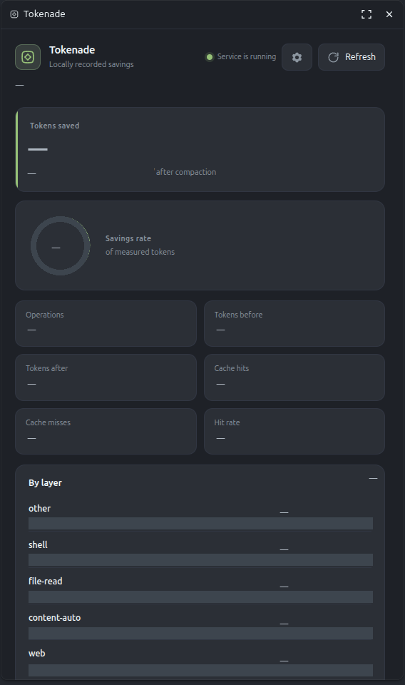
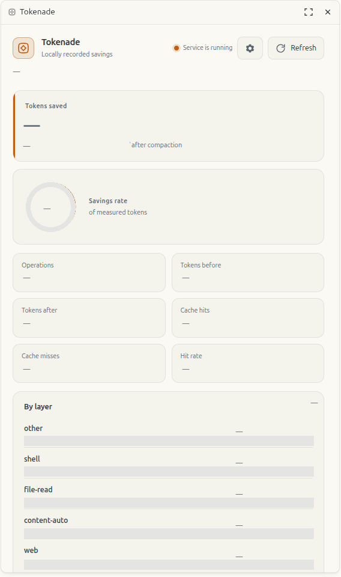

# Tokenade Dashboard

OpenChamber extension for viewing locally recorded Tokenade savings and cache statistics.

## Screenshots

<p align="center">
  
  
</p>

Usage figures are masked for privacy.

## Requirements

- Tokenade CLI is a mandatory external dependency. Install Tokenade on the host running the OpenChamber service and ensure `tokenade` is on that service's `PATH`; without it, dashboard requests cannot work.
- OpenChamber `1.24.0` or later.

## Features

- View token savings, savings rate, operation counts, and cache hit metrics.
- Explore breakdowns by layer and operation when the CLI provides them.
- Refresh on demand or automatically while the panel is visible; the default interval is 5 seconds and can be set from 3 to 60 seconds.
- Customize the accent with the color swatch. The default follows the host theme; color choices require **OK** then **Save**, while **Cancel**, Escape, or clicking outside discards a candidate. **Restore default** removes the override.
- The ready dot follows the accent; warning and error indicators retain their semantic host colors.

## Install in OpenChamber

1. Open **Settings → Extensions**.
2. Install this repository:

   `https://github.com/boureaujm/openchamber-tokenade`

   The repository is private, so your OpenChamber environment must have access to it.
3. Approve the Tokenade local service when prompted.

## Permissions

The host service runs the fixed `tokenade dashboard --json` command with shell execution disabled. OpenChamber asks for approval before starting the service. Its declared `exec` permission is advisory, not a sandbox: the service runs with your user privileges.

## Development

```sh
bun install --frozen-lockfile
bun run build
```

The build regenerates `panel/main.js` and `service/main.js`; edit their TypeScript sources instead of the generated bundles.
`@openchamber/sdk` is a dev dependency used by the bundler; its code is included in the generated bundles.

## How it works

The panel requests one-shot JSON snapshots and polls at the configured interval while visible. Preferences use device-scoped host storage. The service normalizes the CLI's `cache_hit_rate` field to `hit_rate` for the panel.
